# 🏭 Multi Role Tracking: Vehicle Manufacturing Tracker

A **Power Apps Canvas app on 8 Dataverse tables** that digitizes role-based operational tracking across a vehicle manufacturing floor, from Procurement and Assembly to Production, Testing/Inspection, Warehouse and Showroom. Each screen switches between **Edit and View** automatically for the logged-in user using Dataverse lookups.

   

> 🔗 **Live project page:** https://javedmcs83-ali.github.io/Multi-Role-Tracking-Power-Apps/

> ℹ️ Independent learning project. "TATA Motors" is only a fictional scenario name; this project is not affiliated with, built for, or endorsed by Tata Motors Limited. All data is synthetic.

## 🎯 Problem
- Each function tracked its own status manually, with no single source of truth
- Anyone with the sheet could edit any section, regardless of role
- No way to tie an update to the manager or supervisor responsible
- Leadership had no consolidated view of a unit across the production lifecycle

## 👥 Roles
Procurement Manager · Assembly Manager · Production Manager (access-control anchor) · Production Supervisor · Tester / Inspection Manager · Warehouse Manager · Showroom Manager, plus a master **User** table (name and email) used to identify the logged-in user.

## 🗂️ Dataverse tables (8)
| Table | Purpose |
|---|---|
| Tbl_Production_Manager_Section | Core; lookup columns to User for each role, drives Edit/View on all screens |
| Tbl_Showroom_Manager_Section | Showroom readiness and dispatch |
| Tbl_Assembly_Manager_Section | Assembly line tracking |
| Tbl_Procurement_Manager_Section | Procurement tracking |
| Tbl_Production_Supervisor_Section | Production supervision |
| Tbl_Tester_Inspection_Manager_Section | Testing and inspection |
| Tbl_Warehouse_Manager_Section | Warehouse and inventory |
| User | User Name, User Email; referenced by lookups |

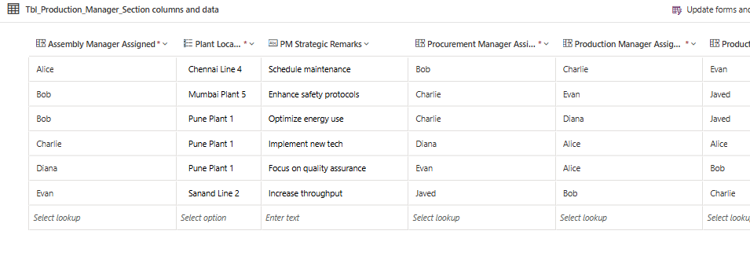

## 🔐 Lookup-driven Edit / View access control
1. Match `User().Email` against the User table with `LookUp()` to get the logged-in user's name
2. Set role flags (`IsProductionManager`, `IsProductionSupervisor`) by comparing that name to the role lookup columns, using `Lower(Trim())` on both sides
3. Each screen's form `DisplayMode` reads its own flag (Edit for a match, View otherwise)

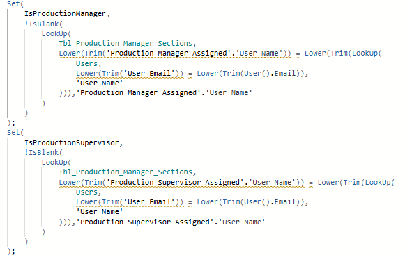

## 📱 7 role-based screens
**Production Manager**
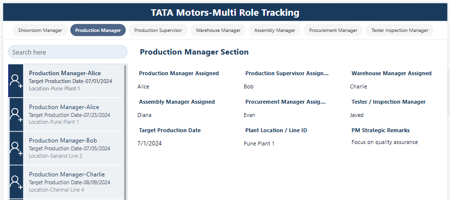

**Showroom Manager**
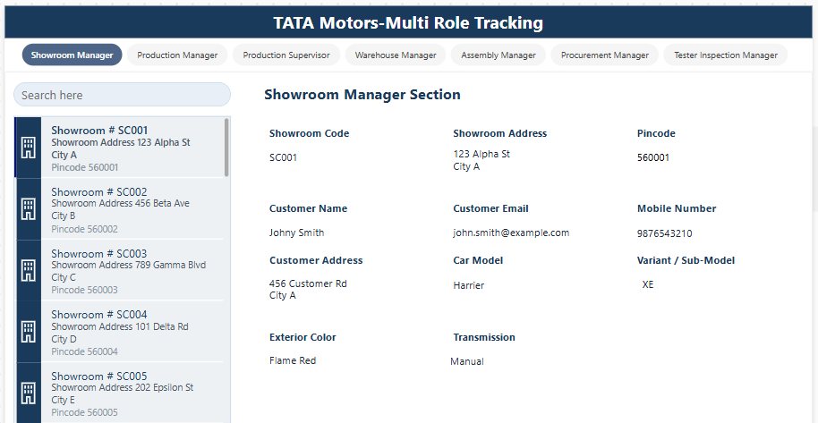

**Assembly Manager**
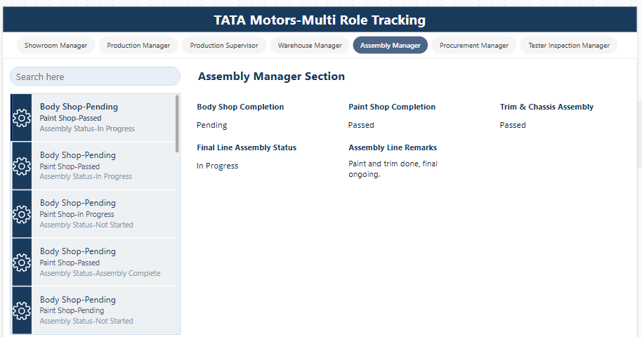

**Procurement Manager**
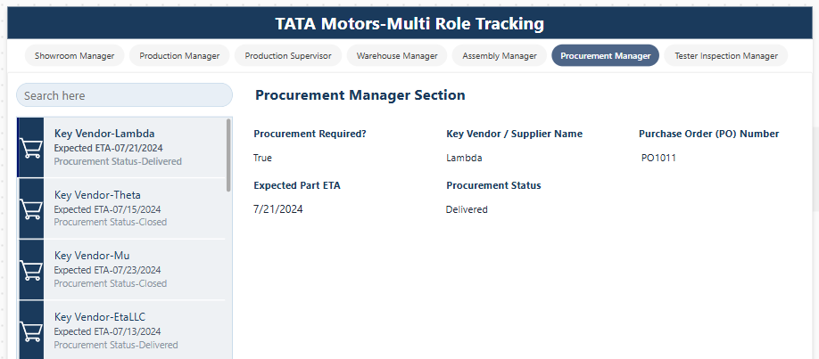

**Production Supervisor**
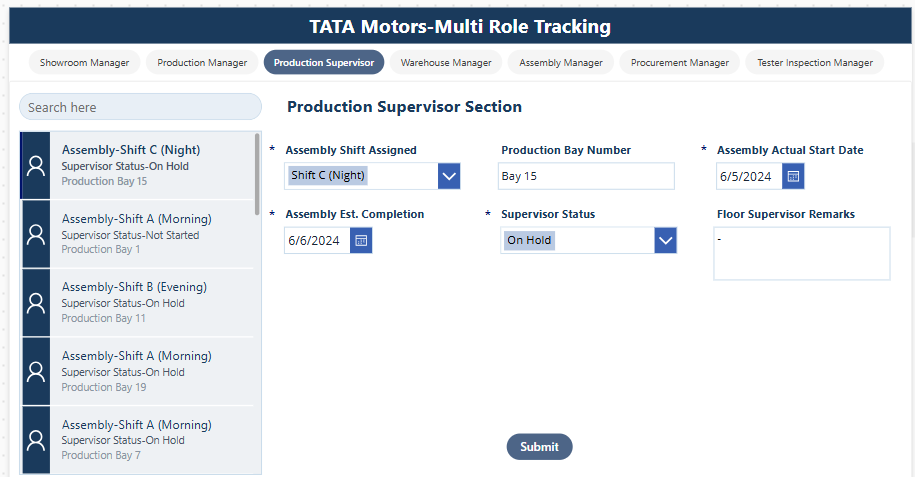

**Tester / Inspection Manager**
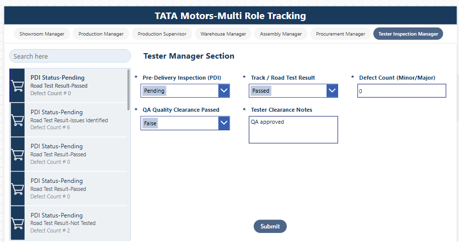

**Warehouse Manager**
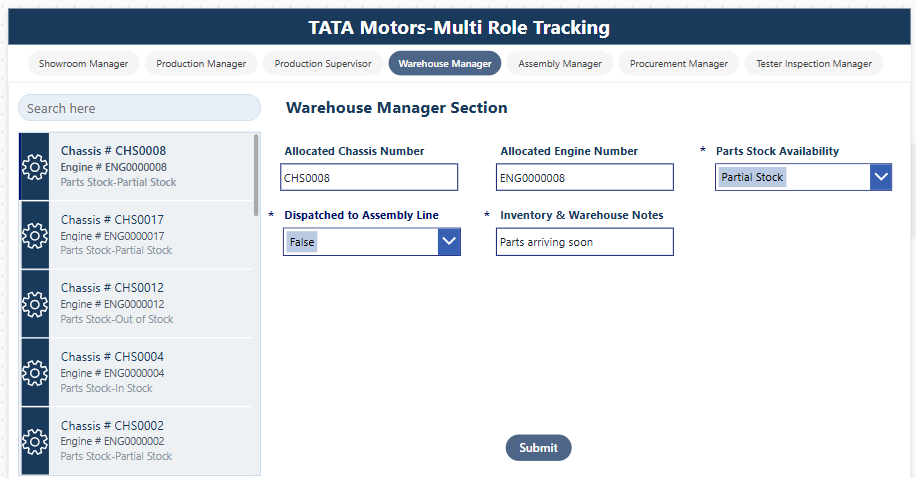

## 🚀 ALM: DEV → PROD
Built in DEV with the app and 8 tables in a solution, with environment variables and connection references enabled. The solution was exported as **Managed** and imported into PROD, where connection references were re-bound and data migrated.

**DEV (unmanaged, 9 objects)**
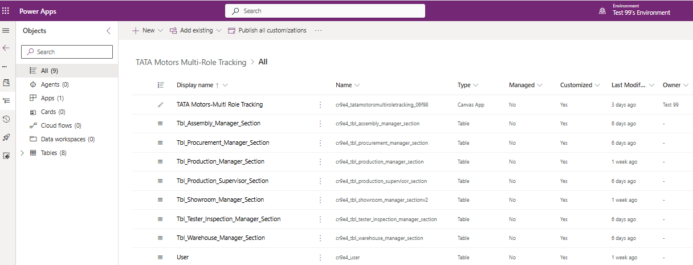

**PROD (managed, objects locked)**
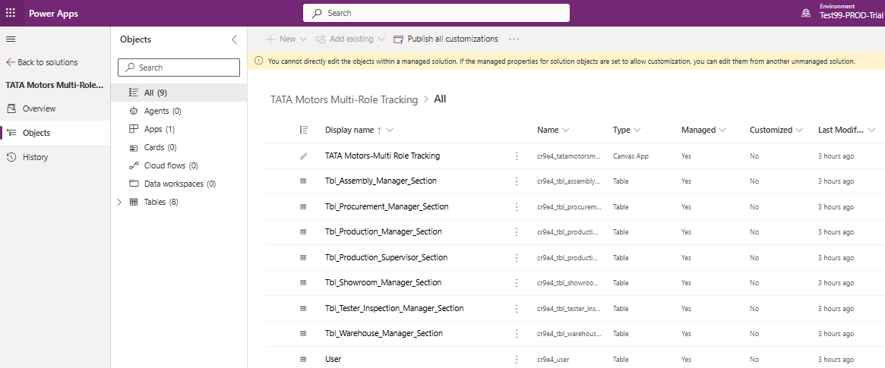

## 🛠️ Tech stack
Power Apps Canvas · Microsoft Dataverse · Solutions · Environment Variables and Connection References · Power Fx

## 📈 Delivered
8 tables · 7 role-based screens · 1 source of truth · role access enforced by lookup match, with no per-user permission setup · 0 cross-role editing · full DEV→PROD ALM cycle

## 👤 Author
**Javed Pinjari**: Power Platform Developer · [LinkedIn](https://www.linkedin.com/in/javed-pinjari-0a176582/) · [GitHub](https://github.com/javedmcs83-ali)
